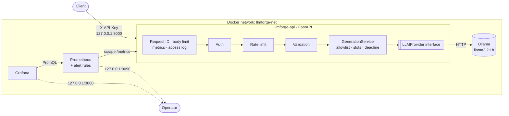
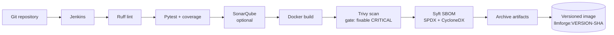

# LLMForge

**Deploy, observe, evaluate and operate local LLM applications with DevOps best practices.**

[](https://www.python.org/)
[](https://fastapi.tiangolo.com/)
[](https://ollama.com/)
[](https://prometheus.io/)
[](https://grafana.com/)
[](https://docs.docker.com/compose/)
[](https://github.com/astral-sh/ruff)
[](LICENSE)

LLMForge is a self-hosted **LLMOps platform**. It runs an open-source language model
locally (Ollama + `llama3.2:1b` by default) behind a production-style **FastAPI
gateway**, with authentication, rate limiting, admission control, timeouts, structured
logs, **Prometheus metrics**, a provisioned **Grafana dashboard**, **alert rules**, a
hermetic test suite, and a **Jenkins pipeline** with SonarQube, Trivy and Syft.

It is meant to show how you would *operate* an LLM service, not how to build a
chatbot. Everything runs on a laptop and needs no GPU.

> **Status:** v0.1.0 MVP, verified end to end on a CPU-only Ubuntu host (see
> [docs/IMPLEMENTATION_REPORT.md](docs/IMPLEMENTATION_REPORT.md)). It has not had a
> professional security review. See [SECURITY.md](SECURITY.md).

---

## Contents

- [Architecture](#architecture)
- [Features](#features)
- [Technology stack](#technology-stack)
- [Quick start](#quick-start)
- [API usage](#api-usage)
- [Observability](#observability)
- [Testing](#testing)
- [CI/CD](#cicd)
- [Security](#security)
- [Project layout](#project-layout)
- [Troubleshooting](#troubleshooting)
- [Roadmap](#roadmap)
- [Contributing](#contributing) · [License](#license)

## Architecture





The API layer only knows the `LLMProvider` interface. Ollama is one implementation,
so vLLM or a hosted API can be added without touching the endpoints. Details and
trade-offs: [docs/architecture.md](docs/architecture.md).

## Features

**Gateway**
- `GET /health` (liveness), `GET /ready` (runtime reachable + model pulled), `GET /metrics`
- `GET /v1/models` and `POST /v1/generate`, documented in Swagger at `/docs`
- API-key authentication (`X-API-Key` or `Bearer`), constant-time comparison, fails fast at start-up if misconfigured
- Per-client token-bucket rate limiting (429 + `Retry-After`)
- Concurrency protection: bounded generation slots with a queue timeout (503 + `Retry-After`)
- Connect, inference and overall-deadline timeouts (504)
- Validation: prompt length, model allowlist and name pattern, `max_tokens` and `temperature` bounds, unknown fields rejected, body size limit (413)
- Uniform error envelope with request ID, and no stack traces or runtime internals sent to clients
- Correlation IDs (`X-Request-ID`) and W3C `traceparent` trace IDs in every log line
- Structured JSON logs that record prompt *length* only, never prompts or keys

**Operations**
- Pluggable provider architecture (`app/providers/`)
- 11 Prometheus metrics with bounded labels, including model availability from a background probe
- Grafana dashboard (15 panels) and datasource, provisioned automatically
- 4 Prometheus alert rules: API down, model unavailable, high error rate, high inference latency
- Docker Compose stack: health-checked start-up order, named volumes, dedicated network, localhost-only ports, read-only root filesystems, all capabilities dropped, images pinned by digest
- The model is downloaded explicitly. The API never downloads models at start-up

**Quality**
- 87 hermetic unit tests (98% coverage) plus 6 integration tests against the live stack
- Jenkinsfile: lint → tests → coverage gate → SonarQube → build → Trivy → Syft → archive

## Technology stack

| Layer | Technology |
|-------|------------|
| Gateway | Python 3.12, FastAPI 0.162, Pydantic v2, pydantic-settings, HTTPX, Uvicorn (uvloop/httptools) |
| Runtime | Ollama 0.40.12, `llama3.2:1b` (configurable) |
| Metrics / dashboards | prometheus-client, Prometheus v3.13.5, Grafana 13.2.5 |
| Packaging | Docker multi-stage build on `python:3.12.16-slim-trixie`, Docker Compose v2 |
| Testing | pytest, pytest-asyncio, pytest-cov, respx, FastAPI TestClient |
| CI / supply chain | Jenkins, Ruff, SonarQube (scanner CLI image), Trivy 0.75.0, Syft 1.54.1 |

## Quick start

### Prerequisites

- Docker Engine with the Compose v2 plugin
- ~10 GiB free disk and ~4 GiB free RAM. No GPU needed
- `curl` and `python3` for the helper scripts

### 1. Configure

```bash
git clone https://github.com/<your-user>/llmforge.git
cd llmforge
./scripts/setup.sh
```

`setup.sh` checks prerequisites and writes `.env` (git-ignored, mode 600) with a
generated API key and Grafana password.

### 2. Start the stack

```bash
docker compose up -d --build
docker compose ps        # all four services should become "healthy"
```

### 3. Download the model (one-time)

```bash
./scripts/download-model.sh            # pulls llama3.2:1b (~1.3 GB) into a persistent volume
curl -s http://127.0.0.1:8000/ready    # -> {"status":"ready", ...}
```

### 4. Smoke test

```bash
./scripts/smoke-test.sh
```

### Local URLs

| Service | URL | Credentials |
|---------|-----|-------------|
| API | http://127.0.0.1:8000 | `X-API-Key` from `.env` |
| Swagger UI | http://127.0.0.1:8000/docs | - |
| Prometheus | http://127.0.0.1:9090 | - |
| Grafana | http://127.0.0.1:3000 | `admin` / `GRAFANA_ADMIN_PASSWORD` from `.env` |

### Stop, restart, clean up

```bash
docker compose stop            # stop; keep everything
docker compose start           # resume
docker compose restart         # restart all services
docker compose down            # remove containers/network; KEEP model, metrics, dashboards
docker compose down -v         # remove everything including volumes (model must be re-pulled)
docker image rm llmforge:0.1.0 # remove the API image
```

Full guide and configuration reference: [docs/deployment.md](docs/deployment.md).

## API usage

```bash
export KEY="$(grep '^LLMFORGE_API_KEYS=' .env | cut -d= -f2 | cut -d, -f1)"

curl -s -H "X-API-Key: $KEY" http://127.0.0.1:8000/v1/models

curl -s http://127.0.0.1:8000/v1/generate \
  -H "X-API-Key: $KEY" -H 'Content-Type: application/json' \
  -d '{"prompt": "Explain Kubernetes", "model": "llama3.2:1b", "max_tokens": 64}'
```

```json
{
  "model": "llama3.2:1b",
  "response": "Kubernetes is an open-source container orchestration system for automating the deployment, scaling, and management of containerized applications and services.",
  "prompt_tokens": 33,
  "completion_tokens": 28,
  "duration_seconds": 2.726
}
```

All endpoints, fields and error codes: [docs/api.md](docs/api.md). Interactive docs: http://127.0.0.1:8000/docs.

## Observability

### Metrics

| Metric | Type | Labels | Description |
|--------|------|--------|-------------|
| `llmforge_requests_total` | Counter | `method`, `route`, `status` | HTTP requests (route *template*, never raw path) |
| `llmforge_request_duration_seconds` | Histogram | `method`, `route` | End-to-end HTTP latency |
| `llmforge_active_requests` | Gauge | - | In-flight HTTP requests (includes the scrape itself) |
| `llmforge_inference_duration_seconds` | Histogram | `provider`, `model`, `outcome` | Time waiting on the model runtime |
| `llmforge_active_generations` | Gauge | `provider` | Generations in progress |
| `llmforge_input_tokens_total` | Counter | `provider`, `model` | Prompt tokens reported by the runtime |
| `llmforge_output_tokens_total` | Counter | `provider`, `model` | Completion tokens reported by the runtime |
| `llmforge_generation_errors_total` | Counter | `provider`, `model`, `error_type` | Failures: `runtime_unavailable`, `timeout`, `model_not_found`, `provider_error`, `overloaded` |
| `llmforge_model_availability` | Gauge | `provider`, `model` | 1 = reachable and pulled, refreshed every 30 s |
| `llmforge_rate_limited_total` | Counter | - | Requests rejected with 429 |
| `llmforge_build_info` | Info | `version` | Build metadata |

Cardinality is bounded: `model` only ever takes allowlisted values, unmatched paths
collapse into `route="unmatched"`, and prompts, keys and client IDs are never labels.
Zero-valued series are created at start-up for the known label combinations, so
`rate()`-based alerts catch the *first* error of a new kind.

### Grafana

The **LLMForge Overview** dashboard (folder *LLMForge*) is provisioned automatically
and set as the home dashboard. It shows API health, model availability, total requests,
error rate, active requests and generations, requests/s by route and status, P50/P95/P99
gateway and inference latency, input and output token throughput, and rate-limited requests.
To import it elsewhere: *Dashboards → New → Import* →
[`grafana/dashboards/llmforge-overview.json`](grafana/dashboards/llmforge-overview.json),
then choose a Prometheus datasource.

### Alerts

Defined in [`monitoring/alerts/llmforge-alerts.yml`](monitoring/alerts/llmforge-alerts.yml)
and visible at http://127.0.0.1:9090/alerts:

| Alert | Condition |
|-------|-----------|
| `LLMForgeAPIUnavailable` | `up == 0` for 1 m |
| `LLMForgeModelUnavailable` | availability gauge 0 for 2 m |
| `LLMForgeHighErrorRate` | 5xx ratio on `/v1/*` above 5 % for 5 m (with a minimum traffic guard) |
| `LLMForgeHighInferenceLatency` | P95 inference latency above 30 s for 10 m |

No Alertmanager is deployed in the MVP, so alerts are evaluated but not routed anywhere.

### Logs

One JSON object per line on stdout, including `request_id` and `trace_id` when present:

```json
{"timestamp": "2026-11-01T03:59:31.904142+00:00", "level": "INFO", "logger": "llmforge.access", "message": "request completed", "method": "GET", "path": "/health", "route": "/health", "status_code": 200, "duration_ms": 2.57, "client_ip": "127.0.0.1", "request_id": "3e07c86a10b8481f8186dfd24b62ac19"}
```

### Limitations of local measurements

- **Token counts come from the runtime.** Ollama reports `prompt_eval_count` and
  `eval_count`. When a prompt is served from Ollama's cache the prompt count can be
  missing. The API then returns `null` and the counter is left unchanged, so input
  throughput is a lower bound.
- **Token throughput panels** show `rate()` over the scrape window, averaged across
  requests. They are not per-request decode speed, and they read zero while idle.
- **Latency depends on hardware.** On CPU the first request after an idle period also
  includes loading the model (`OLLAMA_KEEP_ALIVE`). The 30 s latency alert threshold
  is a starting point to tune.
- **Resource usage is not exported.** Ollama has no Prometheus endpoint, and the MVP
  does not ship cAdvisor or node-exporter. Use `docker stats` for CPU and memory, or
  add those exporters (see the roadmap).
- Rate-limiter and concurrency state is per process. Metrics describe one API replica.

## Testing

```bash
python3.12 -m venv .venv && .venv/bin/pip install -r requirements-dev.txt
# (Ubuntu without python3.12-venv: see CONTRIBUTING.md)

.venv/bin/pytest --cov                 # unit tests: no Ollama, no network, ~3 s
.venv/bin/pytest -m integration        # integration tests: needs the running stack + model
./scripts/smoke-test.sh                # shell end-to-end check of the deployed stack
```

- **Unit tests** (`tests/unit/`, 87 tests) use an in-process `FakeProvider` and `respx`
  HTTP mocks. They cover all endpoints, validation, auth, rate limiting, concurrency,
  timeouts, provider error mapping, metrics, logging privacy and the Ollama client.
- **Integration tests** (`tests/integration/`, 6 tests, marker `integration`) call the
  live API → Ollama path: readiness, model listing, real generation with metric deltas,
  live auth and validation, and the real Ollama client against an unreachable runtime.
- The default `pytest` run excludes integration tests, so CI never needs Ollama or a model download.

## CI/CD

The [Jenkinsfile](Jenkinsfile) defines a declarative pipeline:

| Stage | What it does | Fails the build when |
|-------|--------------|----------------------|
| Checkout | Resolves the image tag (`IMAGE_TAG` param or `<version>-<sha7>`) | tag is invalid |
| Python environment | venv + `requirements-dev.txt` | install fails |
| Lint | `ruff check`, `ruff format --check` | any finding |
| Unit tests | pytest with JUnit and coverage XML/HTML | any test fails |
| Coverage report | `coverage report --fail-under=$COVERAGE_MIN` (85) | coverage below threshold |
| SonarQube analysis | scanner CLI container, run only when `RUN_SONAR=true` | scanner error |
| Quality gate | `waitForQualityGate`, only when enabled | gate fails |
| Docker build | OCI labels, version and revision build args | build fails |
| Trivy scan | JSON and table reports, Dockerfile misconfiguration scan | fixable vulns at `TRIVY_FAIL_SEVERITY` (default `CRITICAL`) |
| SBOM (Syft) | SPDX and CycloneDX JSON | Syft error |
| Archive artifacts | `reports/**` with fingerprints | - |

The pipeline assumes no credentials. SonarQube authentication comes from the Jenkins
SonarQube server configuration via `withSonarQubeEnv`, and no secret is echoed.
**Deployment is deliberately not part of the pipeline.** Publishing and deploying
should be a separate, manually approved job for trusted branches, never for fork PRs.
`sonar-project.properties` points SonarQube at `app/`, `tests/` and the coverage and
JUnit reports.

Every stage except SonarQube was run locally with the same commands
(see the implementation report). The Jenkinsfile itself has not been run on a Jenkins server yet.

## Security

Main controls: API-key auth, rate and concurrency limits, input validation, timeouts,
no prompt logging, sanitized errors, non-root read-only containers with all
capabilities dropped, localhost-only ports, Ollama kept off the host network, pinned
dependencies and images, Trivy scanning and an SBOM. Read
[SECURITY.md](SECURITY.md) for the full list, known limitations and local scanning commands.

## Project layout

```
llmforge/
├── app/
│   ├── main.py              # app factory + lifespan
│   ├── __main__.py          # container entrypoint (python -m app)
│   ├── config.py            # pydantic-settings, fail-fast validation
│   ├── dependencies.py      # auth, rate limiting, state accessors
│   ├── api/                 # routers (health, v1) + exception mapping
│   ├── middleware/          # request context: IDs, metrics, access log, body limit
│   ├── providers/           # LLMProvider ABC, Ollama implementation, registry
│   ├── services/            # generation, rate limiter, model monitor, errors
│   ├── schemas/             # Pydantic request/response models
│   ├── metrics/             # Prometheus metric definitions
│   └── logging/             # JSON logging + request/trace context
├── tests/
│   ├── conftest.py          # FakeProvider, settings and client fixtures
│   ├── unit/                # hermetic tests (default)
│   └── integration/         # live-stack tests (-m integration)
├── monitoring/
│   ├── prometheus/prometheus.yml
│   └── alerts/llmforge-alerts.yml
├── grafana/
│   ├── dashboards/llmforge-overview.json
│   └── provisioning/{datasources,dashboards}/
├── scripts/                 # setup.sh, download-model.sh, smoke-test.sh
├── docs/                    # architecture, api, deployment, troubleshooting, report
├── Dockerfile · docker-compose.yml · Jenkinsfile · sonar-project.properties
├── requirements.txt · requirements-dev.txt · pyproject.toml
└── .env.example · .gitignore · .dockerignore · LICENSE · SECURITY.md · CONTRIBUTING.md
```

## Troubleshooting

Common problems (`/ready` 503, timeouts, 429/503 responses, empty Grafana panels,
port clashes, venv issues) are covered in [docs/troubleshooting.md](docs/troubleshooting.md).

## Roadmap

- [ ] Streaming responses (`stream: true`, Server-Sent Events) with time-to-first-token metrics
- [ ] vLLM provider (OpenAI-compatible) and a hosted-API provider
- [ ] OpenTelemetry tracing (OTLP exporter) across gateway and runtime
- [ ] Evaluation harness: golden-prompt regression suite with quality and latency scores in CI
- [ ] Alertmanager with notification receivers
- [ ] cAdvisor / node-exporter for container and host resource dashboards
- [ ] Redis-backed distributed rate limiting and per-key quotas
- [ ] Kubernetes manifests / Helm chart with readiness gating on `/ready`
- [ ] Distroless or minimal base image to reduce OS-package CVEs
- [ ] Image signing (cosign) and SBOM attestation

## Contributing

Contributions are welcome. See [CONTRIBUTING.md](CONTRIBUTING.md) for setup, coding
guidelines and the pre-PR checklist.

## License

[MIT](LICENSE)
