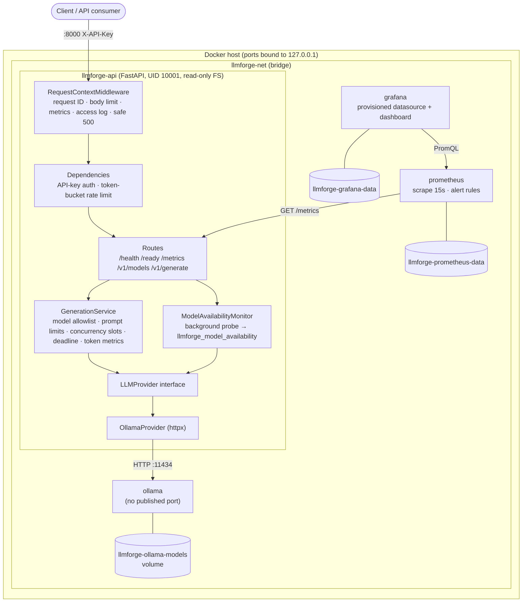

# Architecture

## Overview



## Request lifecycle (`POST /v1/generate`)

1. **RequestContextMiddleware** (raw ASGI, outermost) assigns or accepts a
   validated `X-Request-ID`, extracts a W3C `traceparent` trace ID, rejects
   bodies larger than `LLMFORGE_MAX_REQUEST_BODY_BYTES` (413), increments
   `llmforge_active_requests`.
2. **Authentication** dependency checks `X-API-Key` (or `Authorization: Bearer`)
   against configured keys in constant time → 401.
3. **Rate limiting** dependency consumes a token from the caller's bucket
   (keyed by a hash of the API key, or the client IP when auth is disabled) → 429.
4. **Validation**: Pydantic schema (`extra="forbid"`, pattern-checked model name,
   bounded numeric fields) → 422 with the prompt stripped from error details.
5. **GenerationService** resolves the model against the allowlist (400),
   enforces `LLMFORGE_MAX_PROMPT_CHARS` and `max_tokens` (422), then acquires
   one of `LLMFORGE_MAX_CONCURRENT_GENERATIONS` slots, waiting at most
   `LLMFORGE_QUEUE_TIMEOUT_SECONDS` (503 + `Retry-After`).
6. The provider call runs under an `asyncio.timeout` deadline
   (`LLMFORGE_GENERATION_TIMEOUT_SECONDS`) on top of httpx connect/read timeouts (504).
7. Provider errors map to stable public codes: runtime unreachable → 503,
   model not pulled → 503, runtime 5xx → 502, timeout → 504.
8. Token counts reported by the runtime increment the token counters; the
   middleware records `llmforge_requests_total` / `llmforge_request_duration_seconds`
   using the **route template** and writes one JSON access-log line.

## Components

| Path | Responsibility |
|------|----------------|
| `app/main.py` | Application factory, lifespan (starts the availability probe, closes the provider) |
| `app/config.py` | `pydantic-settings` configuration; fails fast on insecure combinations |
| `app/middleware/` | Correlation IDs, body limit, HTTP metrics, access log, last-resort error handler |
| `app/dependencies.py` | State accessors, authentication, rate limiting |
| `app/api/` | Routers (`health.py`, `v1.py`) and exception → HTTP mapping (`errors.py`) |
| `app/services/` | Generation orchestration, rate limiter, model monitor, domain errors |
| `app/providers/` | `LLMProvider` ABC, `OllamaProvider`, provider registry |
| `app/metrics/` | All Prometheus metric definitions in one place |
| `app/logging/` | JSON formatter, contextvars for request/trace IDs |
| `app/schemas/` | Request/response models (also drive the OpenAPI docs) |

## Provider abstraction

Routes and services depend only on `app.providers.base`:

```python
class LLMProvider(ABC):
    name: str

    async def list_models(self) -> list[ModelInfo]: ...
    async def generate(self, request: GenerationRequest) -> GenerationResult: ...
    async def is_model_available(self, model: str) -> bool: ...  # default via list_models
    async def close(self) -> None: ...
```

Errors are expressed as `ProviderUnavailableError`, `ProviderTimeoutError`,
`ModelNotFoundError` and `ProviderError`, so the HTTP layer never needs to
know which runtime produced them. To add a runtime (e.g. vLLM's
OpenAI-compatible server):

1. implement `LLMProvider` in `app/providers/vllm.py`;
2. add a factory to `_REGISTRY` in `app/providers/registry.py` (or call
   `register_provider("vllm", factory)`);
3. set `LLMFORGE_PROVIDER=vllm` plus any provider-specific settings.

## Observability design

- **Metrics** are defined once in `app/metrics/__init__.py`. Labels are limited
  to route template, method, status code, provider, allowlisted model, outcome
  and a fixed set of error types - cardinality is bounded by configuration.
  Unmatched paths share the label `route="unmatched"` so scanners cannot
  explode the series count.
- **Model availability** is refreshed by a background task every
  `LLMFORGE_MODEL_PROBE_INTERVAL_SECONDS` (default 30s), not only when
  `/ready` is called, so the `LLMForgeModelUnavailable` alert works unattended.
- **Logs** are one JSON object per line on stdout (Docker's json-file driver,
  rotated at 10 MB × 3). Every line carries `request_id`, and `trace_id` when a
  `traceparent` header was supplied.
- **Tracing**: the gateway is *OpenTelemetry-ready* rather than instrumented -
  it propagates W3C trace IDs into logs and has a single ASGI choke point where
  an OTel middleware/exporter can be added. No OTel SDK is bundled in the MVP.

## Key trade-offs

| Decision | Rationale | Cost |
|----------|-----------|------|
| Non-streaming generation only | Simpler timeout, metrics and error semantics for the MVP | Clients wait for the full completion; streaming is on the roadmap |
| In-memory rate limiter & semaphore | No extra infrastructure; correct for one API process | Limits are per replica; use Redis or a gateway for multi-replica |
| Single uvicorn worker | Keeps limiter/semaphore state coherent and metrics in one registry | One CPU core for request handling (inference happens in Ollama, so this is rarely the bottleneck) |
| Model pull is a separate step | API start-up never depends on internet access or multi-GB downloads | One extra command on first install |
| `/health` used for the container healthcheck, `/ready` for traffic gating | A missing model should not make Docker restart the API | Compose shows the API "healthy" before the model is pulled - check `/ready` |
| Ollama runs as root (upstream image) | The official image expects `/root/.ollama`; a custom image adds maintenance | Mitigated with `cap_drop: ALL`, `no-new-privileges`, read-only root FS, no published port |
| Unauthenticated `/metrics` | Standard Prometheus scraping without credential plumbing | Must not be exposed beyond the trusted network |
| No Kubernetes / Alertmanager in v0.1 | Keep the MVP small and runnable on a laptop | See roadmap |
